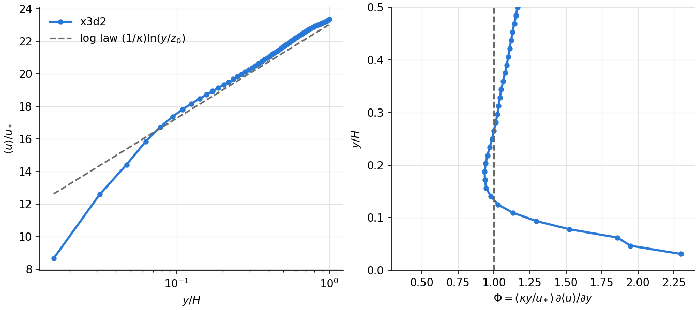
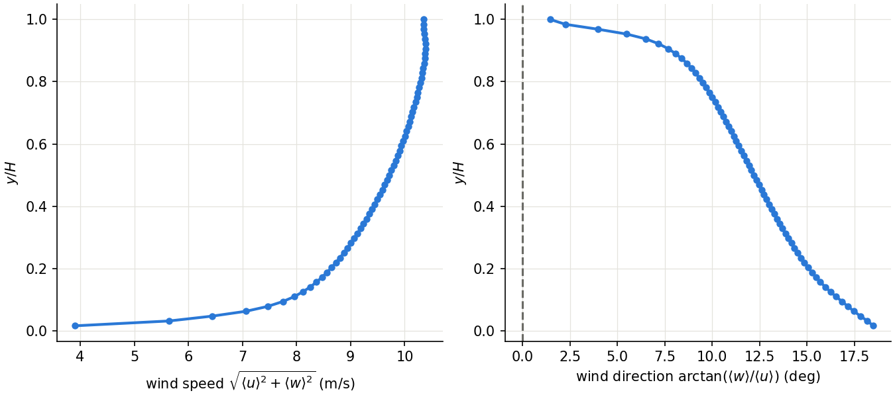

Neutral atmospheric boundary layer
==================================

``examples/abl`` simulates a neutral atmospheric boundary layer (ABL) over a
rough wall. It is the case C1 of :cite:`deskos_phd_19` (Ch. 5), a standard
test of a wall-modelled LES: away from the wall, the mean wind should follow
the logarithmic law of the wall.

The directory holds two inputs:

``input.x3d``
   The neutral ABL driven by a constant pressure gradient.

``input_ekman.x3d``
   The Ekman variant: the same box and grid, driven by a geostrophic wind on a
   rotating frame instead (see `Ekman variant`_).

``plot_profiles.py`` plots the mean profiles both runs write.
The model and its equations are described in :ref:`abl-theory`, and every
parameter in :doc:`../input_file`.

Setup
-----

.. list-table::
   :widths: 35 65

   * - Domain
     - :math:`L_x \times L_y \times L_z = \pi H \times H \times \pi H`,
       :math:`H = 1000` m, with :math:`y` vertical
   * - Grid
     - :math:`64 \times 65 \times 64`, uniform:
       :math:`\Delta x = \Delta z \approx 49` m, :math:`\Delta y = 15.6` m
   * - Boundaries
     - periodic in :math:`x` and :math:`z`, free-slip lid, rough wall at the
       floor
   * - Roughness, friction velocity
     - :math:`z_0 = 0.1` m, :math:`u_* = 0.45` m/s, :math:`\kappa = 0.4`
   * - Forcing
     - uniform pressure gradient :math:`u_*^2/H` along :math:`x`
   * - SGS model
     - Smagorinsky, :math:`C_s = 0.14`, with Mason--Thomson wall damping
       (:math:`n = 3`) :cite:`mason_jfm_92`
   * - Wall model
     - log-law stress from the velocity sampled 3 grid spacings above the
       floor (``dsampling = 3``)
   * - Time
     - :math:`\Delta t = 0.8` s, 125000 steps (100000 s, about
       :math:`45\,H/u_*`)
   * - Statistics
     - the second half of the run, steps 62500--125000

The initial field is the log law plus random noise. The noise seed is printed
in the log (``ABL noise seed: N``); set ``seed = N`` in ``abl_nml`` to repeat
a run exactly.

Running the case
----------------

Run each input in its own directory, since the output goes to the working
directory:

.. code-block:: bash

   mkdir neutral && cd neutral
   cp /path/to/x3d2/examples/abl/input.x3d .
   mpirun -np 1 /path/to/x3d2/build/bin/xcompact input.x3d

The run takes about an hour on one NVIDIA A100. If you run on more ranks,
do not decompose :math:`y`: the profile diagnostics need it on a single
rank.

The run writes:

``abl_profile.csv``
   The horizontally and time-averaged velocity profile and the analytical log
   law, rewritten every ``n_output`` steps from step 62500 onwards. Its header
   gives the imposed and the diagnosed friction velocity (from the mean wall
   stress).

``monitoring.csv``
   Kinetic energy, enstrophy and velocity divergence over time.

``abl_checkpoint_*.bp``
   A restart file every 12500 steps (the latest one is kept).

To plot the mean profiles once the run has finished:

.. code-block:: bash

   python3 /path/to/x3d2/examples/abl/plot_profiles.py --profile abl_profile.csv

The script needs NumPy and Matplotlib, and writes ``abl_neutral_profiles.png``.

Results
-------

   Left: mean streamwise velocity against the log law. Right: non-dimensional
   shear :math:`\Phi`.

The left panel shows the mean wind :math:`\langle u\rangle/u_*` against
:math:`y/H`. Above about :math:`0.07H` it follows the log law
:math:`(1/\kappa)\ln(y/z_0)` within about 2%. Below that it falls under it:
by 12% at the second grid point and 31% at the first.

The right panel shows the non-dimensional shear

.. math::

   \Phi = \frac{\kappa y}{u_*}\frac{\partial\langle u\rangle}{\partial y},

which is 1 for an exact log law. :math:`\Phi` is close to 1 between
:math:`0.12H` and :math:`0.3H`, and rises slowly towards the lid. Near the
wall it overshoots, to about 2.3 at the second grid point (:math:`y = 31` m).
The point at the first grid point is not shown, because the central difference
there spans the floor.

An overshoot of :math:`\Phi` near the wall is a known feature of
wall-modelled LES. Its size depends on the wall model, the SGS model and the
grid aspect ratio :math:`\Delta x/\Delta y` :cite:`mason_jfm_92,
deskos_phd_19`, so the peak value here applies to this grid and wall model.

The friction velocity diagnosed from the mean wall stress is 0.430 m/s,
4.5% below the imposed 0.45 m/s.

Ekman variant
-------------

``input_ekman.x3d`` drives the same boundary layer as the atmosphere does:
by a geostrophic wind on a rotating frame rather than by a pressure gradient
along :math:`x`. The changes from ``input.x3d`` in ``abl_nml`` are:

.. code-block:: fortran

   u_geo = 10d0, 0d0, 0d0    ! geostrophic wind, m/s
   coriolis_freq = 1d-4      ! f, 1/s
   init_noise = 0.05d0, 0.05d0, 0.05d0
   pressure_gradient = F
   coriolis = T
   damping = T
   profile_file = 'abl_ekman_profile.csv'

The Coriolis force :math:`f\,(w,\,0,\,-u)` and the large-scale pressure
gradient that balances it at the geostrophic wind :math:`(U_g, 0, 0)` replace
the pressure-gradient forcing. The flow starts from the uniform geostrophic
wind with 5% noise. A Rayleigh damping layer at the lid (``damping``)
holds the flow there close to a reference wind. In the damping layer,
:math:`v` and :math:`w` relax towards the geostrophic wind and :math:`u`
towards :math:`(u_*/\kappa)\ln(H/z_0)`, which is why ``u_star`` is still
set. The friction velocity is now a result of the run, not an input.

Run it like the neutral case, then:

.. code-block:: bash

   python3 /path/to/x3d2/examples/abl/plot_profiles.py \
       --ekman-profile abl_ekman_profile.csv

   Left: mean wind speed. Right: wind direction, measured from the
   geostrophic wind (:math:`x`).

The wall stress slows the wind near the ground, and the Coriolis force then
turns it towards lower pressure: the wind direction turns with height, the
*Ekman spiral*. Near the ground the wind blows about :math:`18^\circ` from
the geostrophic direction. The angle falls steadily with height (by about
:math:`8^\circ` between :math:`0.05H` and :math:`0.8H`) and drops to near
zero in the damping layer. The diagnosed friction velocity is 0.426 m/s.
